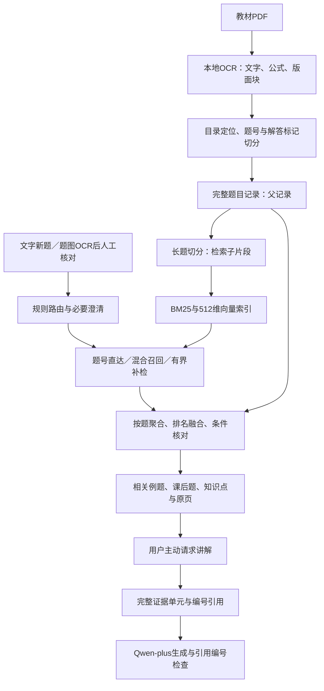

# 本项目的RAG思路与分块设计

更新：2026-11-05。依据当前全书检索代码与本机索引核查，不把规划写成已实现功能。本项目由用户提出辅导场景、提供材料与反馈，助手协助实现及验证；下面也作为本人复现学习材料。

同日后续已完成保护公式的分块与Top K开发对照，详见[召回、Top K与评估指南](召回TopK与评估指南.md)。当前1070片，320字符是软目标、480 tokens是硬预算；下文保留优化前字符窗口及边界审计作为对照，并注明历史状态。

## 1. 先定义任务：找题与复习导航

输入一道新题，首先需要找到茆书中可参考的例题、课后题，说明相似条件、差异和相关知识点，并能打开原页。生成完整解答是后续可选分支。

模型会解统计题，不代表它知道这本教材的准确题号、所在页码、讲义关联和课程安排。这些私有课程资料才是检索的主要价值。不能用“RAG一定提高数学解题准确率”解释本项目；已经完成的小规模生成对照也没有证明这项总体收益。

完整系统含检索和增强生成。只点击查题时，运行的是检索与复习导航链路，不调用生成模型；主动请求讲解时，才把检索证据交给Qwen-plus API。当前没有实际本地部署Qwen。



## 2. 第一层切分：按题目和教材结构组织

原始PDF不是直接按固定长度塞进向量库。先进行结构整理，再产生题目记录。

1. OCR保留文字、LaTeX、原始块ID、PDF页码、版面位置和来源指纹。页眉页脚等在整理时过滤，原始输出保留。
2. 利用目录、小节标题、习题标题、题号及例题标记确定记录边界；连续页允许延续同题，缺页或跨章时停止自动延续。
3. 习题按编号形成记录；例题尝试用“解／证明”等标记区分题干与讲解。没有可靠标记时只取开头段落，并保留未解决状态。
4. 教材参考答案走独立通道，不作为题干检索的输入。题目关联原页、讲义和答案位置，方便后续核对。

父记录的主要字段：`id、kind、label、chapter、section、pages、block_ids、source_sha256、question_text、search_text、full_text、stem_boundary、review_flags`。

`question_text`是当前抽取的题干，`search_text`是去除展示标签后的可检索文本，`full_text`保留原条目内容。检索不直接嵌入`full_text`，但边界抽取不完美时，`question_text`仍可能夹带讲解或遗漏条件，不能宣称已完全分离。

截至本次核查，有1009条题目记录：735道课后题、274条例题候选。例题中141条通过显式解答标记取题干、34条有原块跨度核对记录，另99条仍是开头段落回退。原块核对来自助手工作，不等于教师审核通过。

## 3. 第二层切分：短片段检索，完整题目展示

按题切分保证有可回到的完整记录，但长题可能包含多问、公式和较长条件，不适合全部压入一个小型嵌入模型。于是再拆为子片段，命中后聚回父题目。这是自行实现的父子记录检索思路，没有调用LangChain的父子检索器。

初始参数来自`exercise_vectors.py`，下表为本日优化前基线配置，并非已确定最优值。后续版本在相同token硬预算下保护公式并合并短尾，见本节末更新。

| 参数 | 当前实现 | 用途和边界 |
| --- | --- | --- |
| 子片段正文上限 | 320个字符 | 不是320 tokens；短题不补齐 |
| 相邻重叠 | 最多64个字符 | 通常步长256；缩短片段时最多重叠其长度的四分之一 |
| 嵌入输入预算 | 480 tokens | 包含章节／题号前缀与tokenizer特殊token |
| 前缀 | `小节标题 \| 题目标签`，最多100字符 | 让孤立片段保留课程位置提示 |
| 嵌入模型 | BAAI/bge-small-zh-v1.5 | FastEmbed ONNX CPU，512维 |
| 向量存储与搜索 | SQLite＋NumPy精确余弦搜索 | 当前规模没有采用ANN或独立向量数据库 |

程序先取最多320字符，若加前缀后的token数超过480，就逐次缩短候选片段。记录每片的父题ID、起止偏移、token数和内容哈希。注意：这里说的是建库路径；查询侧也有长文本窗口，不能把建库token校验表述为所有查询都有相同显式检查。

优化前真实例子：`mao3-7.2-6`（习题7.2第6题，教材PDF356页）的`search_text`有322字符，形成两个区间，采用左闭右开偏移：

```text
父题： [0 ----------------------------------------------------- 322)
子片0：[0 ----------------------------------------------- 320)  226 tokens
子片1：                                      [256 ---------- 322)   61 tokens
                                             <---重叠64--->
```

两片都带“小节标题＋题号”前缀。命中任一片后，展示父题及原页，而不是把残缺子片段当作完整题目。这一例首片末尾把原文中的`100`切成了`10`，第二片包含完整末尾；也正说明完整父题回取和公式边界保护是两件事，前者不能保证后者已经解决。OCR中的异常排版同样需要原页核对。

### 优化前分块检查与局限（历史对照）

只读核查脚本：`inspect_rag_architecture.py`。报告：`data/private/architecture-20261105/index-and-boundary-inspection.json`。

- 1009条父记录形成1094个子片段；65条父记录有多个子片段，单条最多13片。
- 当前正文片段11—320字符，嵌入输入25—332 tokens，均未超过480预算。
- 子片段区间覆盖全部当前`search_text`；这不证明抽取的题干等于完整、正确的原题。
- 170个去重的内部起止边界中，75处位于LaTeX命令或配对花括号内部，涉及38条记录。

最后一项来自命令及花括号扫描，不是完整TeX语法树，不是OCR错误数或数学错误率，也不包含全部公式切分风险。当时仍是字符窗口切分。

后续版本：新增`formula_chunking.py`，保护命令、花括号、常见数学定界符、公式环境和数字；短题完整保留，长题优先句子边界，必要时延长以容纳完整单元并合并短尾。新版1009题形成1070片，42条记录有多片，正文11—510字符、25—337 tokens；当前题干覆盖完整。本次相同命令／花括号扫描及新增保护范围扫描均未发现内部切点，但不等于OCR或数学正确。超长单元无法完整容纳时保留强制切分警告，本次语料没有触发；320字符已是软目标。上例当前保留为一个完整片段，不再将100切开。独立候选索引通过出处开发对照后已接入Demo，旧索引保留。

## 4. 为什么并行使用BM25和向量

BM25擅长保留术语、数字、符号及明确表述；向量有机会召回用不同说法表达的相似题。中文词法侧采用双字片段，另保留字母／数字token，不能描述成已使用领域分词器。

两个通道先分别按父题聚合：同一题有多片，取其中最大相关分数。否则长题可能因为片段多，在融合时获得不合理的多票优势。再按父题名次做RRF：

```text
RRF(d) = 1 / (60 + 向量名次(d)) + 1 / (60 + BM25名次(d))
```

某通道缺席时该项为0。融合名次而非直接相加原始分数，避免BM25与余弦分数尺度不同。RRF方法来源见[原始论文](https://cormack.uwaterloo.ca/cormacksigir09-rrf.pdf)，本项目的效果需由自己的对照验证。

当前另保留例题、课后题各自的BM25前20候选进入候选并集，减少一种题型挤占全局候选的情况；公式字符特征只辅助排序。数字、分布参数、支持区间、所求量仍需核对。字符结构相似不代表数学等价。

## 5. “Adaptive”在本项目中具体指什么

不是每个输入都跑同一套重流程，也不是训练了论文里的复杂度分类器。

| 输入情况 | 当前处理 |
| --- | --- |
| 有明确教材题号 | 优先按ID／题号定位 |
| 条件不足或超出统计课程范围 | 先澄清／提示范围 |
| 普通新题 | BM25＋向量召回与RRF |
| 可识别的公式结构或表达别名 | 有界补充候选、融合公式特征，不直接替换全部结果 |
| 明确要求教材某个性质及出处 | 补充相应来源性质证据 |

因此准确名称是“规则驱动的自适应检索”。当前不是训练式Adaptive-RAG分类器，也不是有LLM自主规划与反思的完整Agentic RAG。

默认分别组织3条例题、3道课后题，展示匹配依据、条件差异与原页。分布名相同只能提供背景线索；例如都涉及正态分布，不足以把参数估计与假设检验视为同题型。

## 6. 知识点与知识网络从哪里来

当前全书图含163个目录主题锚点、175个规范化知识单元，总计1347个节点、2010条边。边主要是主题的字面提及、小节位置、例题引用、续接引用和来源包含关系。

这张图支持“题目→主题→原书知识单元”的导航，不等于所有题都已有教师审核的“考查某知识点”或“需要某先修”的语义标签。第一章早期先修关系候选与全书图是不同阶段产物，不能混写成全书已完成先修网络。

一条题最多提示相关复习内容，无法据此判断学生薄弱点。真正诊断需要学生作答过程、多题表现及经过审核的题目—技能标签。

## 7. 何时进入增强生成

`rag_generation.py`从当前匹配结果中组织教材性质、定义／定理、相关题干和例题原文等证据，最多8个证据单元、总计18000字符。放不下的单元整项跳过，避免在生成证据组织阶段从公式中间裁掉一半；这与检索建库的字符切片是不同阶段。

证据附`E1、E2…`编号、记录ID与PDF页码。模型收到用户问题、证据与回答约束，按提示／步骤／完整解答生成。当前真实调用是Qwen-plus API，`temperature=0`、`max_tokens=1800`，未实际部署本地Qwen。

生成后检查引用编号是否存在。该检查不能证明引用支持结论，也不能证明推导正确；温度为0同样不是正确性保证。[RAG原始论文](https://arxiv.org/abs/2005.11401)可以帮助理解外部检索与生成结合，本项目具体链路以上述代码为准。

## 8. 当前有哪些效果证据

2026-11-04冻结的24条已知出处改写题，覆盖八章、8条例题和16道课后题。后续用于优化，因此明确属于开发集。

| 方法 | 首位找回预定原题 | 前三找回预定原题 |
| --- | --- | --- |
| BM25 | 21/24 | 22/24 |
| 仅向量 | 13/24 | 18/24 |
| 固定混合 | 18/24 | 20/24 |
| 原对应流程 | 19/24 | 20/24 |
| 优化后对应流程 | 22/24 | 23/24 |

这是“已知出处定位”的指标，不是所有相关题的准确率，也没有证明学生新题、知识点标签或生成解答的正确率。固定混合不如BM25，说明不能把使用向量库本身当成进步；后续必须保留BM25基线并做消融。

本机独立进程顺序测量中，首轮服务请求中位耗时227.1→190.6毫秒，重复请求217.2→113.3毫秒，首轮P95为263.6→306.1毫秒。学生查书耗时需另行测量。原始数据保存在本机实验档案。

## 9. 下一轮优先改什么

按业务目标，先改题干完整性和相关题召回，再考虑换生成大模型。

1. **公式边界回归与进一步拆题**：本轮已完成上述保护范围的切点控制；继续检查更复杂的TeX、OCR残缺与超长公式。细粒度子问题后续可单独检索，但需附共享题设并回到完整父题，尚未实现全面语义拆题。
2. **题干边界审核**：优先核对99条开头回退例题和异常超长记录。分块完美也不能修复原题抽取错误。题图、表格与OCR符号单独处理。
3. **教师相关性集**：选未用于调参的新题，分别标注“同知识点”“同解法／条件相近”“只是背景相似”和应排除的条件冲突。一个输入可有多个相关例题及课后题，不能只规定一个正确ID。
4. **分块与召回消融**：在开发集比较整题、当前320/64、公式安全切分，再比较BM25／向量／混合／公式辅助。报告两类题Recall@3、MRR、条件冲突率、覆盖、索引成本和P95。配置选定后冻结，在未参与调参的人工集验收。
5. **再评生成与教学**：固定生成模型与提示，比较无检索和检索条件下的出处、引用支持、推导正确性与用量；真实试用后再测查找时间及学习收益。

本节第2—5项及第1项的进一步拆题仍为后续计划。上午只读核查保留原报告；同日后续公式边界优化已重建并接入索引，未改写历史评测，没有新增生成API调用，具体结果见新增指南。

## 10. 对照代码学习

| 环节 | 文件 | 自己应完成的练习 |
| --- | --- | --- |
| 整书结构与跨页 | `organize_full_book.py` | 对照原页找一条跨页题的块跨度 |
| 题干与答案边界 | `exercise_collection.py` | 核对一个有“解”的例题与一个无标记例题 |
| 子片段、向量、BM25与RRF | `exercise_vectors.py` | 手算两片的偏移、重叠与一条RRF分数 |
| 自适应主流程 | `full_book_tutor.py` | 比较题号直达、普通题、缺条件输入的trace |
| 对应依据与公式辅助 | `problem_correspondence.py`、`math_fingerprint.py` | 构造同分布但所求量不同的反例 |
| 主题与来源网络 | `question_knowledge.py` | 解释位置关系与考查关系的区别 |
| 生成证据组织 | `rag_generation.py` | 手工核对一个引用是否真的支持结论 |
| 本次索引审计 | `inspect_rag_architecture.py` | 查看风险ID的原题与两侧片段 |

可用于口述的简版：

> 项目优先解决新题到茆书例题、课后题和知识点的对应。我先按题号、教材结构与解答标记抽取完整题目，再把长题拆成带章节前缀的检索片段。BM25和向量分别召回后，先聚回题目，再按排名融合，并用公式特征和条件差异辅助排序。用户先看到相关题和原页，需要讲解时才把来源证据交给模型。当前开发集已测量出处定位，但人工相关性和真实新题还需验证；分块也仍需加强公式边界保护。
