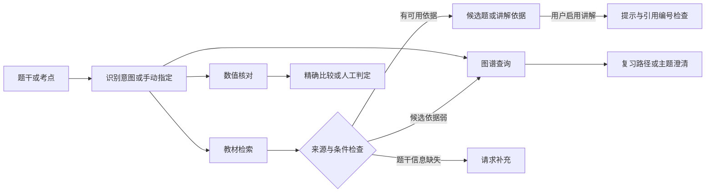

# 知题 Agent 的实现与迭代路线

更新于 2026-11-07。现有题库检索和教材图谱作为可调用工具，Agent 负责选工具、核对输出、处理证据不足，并记录每步的结果。启动原工作台后访问 `/agent`，也可从教材查题页进入。

## 第一版可验收的流程

| 意图 | 工具与判定 | 演示输入 |
| --- | --- | --- |
| 复习知识点 | 从匹配主题沿有出处的关系找教材条目、例题和习题，点击节点看关系和原页 | 复习最大似然估计 |
| 找相关题 | 沿用现有检索。检查原页与已知条件冲突，依据较弱时尝试图谱补充 | 帮我找习题6.1第6题 |
| 获得讲解 | 先组织教材证据。用户启用后调用已配置模型，并检查引用编号 | 讲解习题6.1第6题 |
| 核对答案 | 在明确给出独立、公平、骰子数、面数和单一最大值事件时做精确分数比较。其他题型给出人工判定状态 | 独立掷3颗公平6面骰子，求最大点数恰好等于5的概率。答案栏填写 61/216 |

这一版用规则识别意图，支持手动覆盖。图谱边的含义包括所在小节、原题提及和教材条目。学生掌握度需要另用作答证据衡量。讲解中的引用编号检查只能验证来源是否存在，推导与结论仍需复核。

## 后续迭代

1. **先让一次任务可测。** 用自编请求和已核对的题库请求覆盖歧义意图、条件缺失、低相关候选、正确答案、错误答案和不支持的判定。为每条请求标意图、可接受工具、证据和允许的终态。看路由命中率、工具参数有效率、原页命中和误判率，保留逐条失败。题库来源相关的指标继续使用各自的人工标签。
2. **扩充多轮和复习记录。** 追问后保存明确补充的题干条件，沿同一题继续执行。以题目、考点、作答版本、判定依据和时间保存事件。图谱可以展示实际答过几题、核对了几题和待复习关系。先修或考查边进入审核后再参与学习路径规划。
3. **逐项训练并比较现有基线。** 以核准的「请求、意图、工具、参数」样本做监督训练，覆盖规则难以处理的改写。用题目与教材候选的人工等级训练成对排序器，特别保留分布相同但条件或所求量不同的负例。按题族分组切分，比较规则路由和原排序，并检查误判、拒判覆盖、相关题排序及耗时。排序训练参考 [RankNet](https://www.microsoft.com/en-us/research/publication/learning-to-rank-using-gradient-descent/)。
4. **有足量反馈再优化策略选择。** 将是否补检、候选 K 或是否先澄清定义成有限动作。以人工确认的相关题命中、误判和等待时间设奖励，保存展示与选择概率，先离线比较策略。将用户点击用作信号时，需要处理展示位置影响。参考 [点击反馈偏差研究](https://arxiv.org/abs/1608.04468)。

首个版本已经实现执行记录和保守判定。会话状态、真实学情、模型路由训练和反馈策略实验处于后续阶段。下一次开发优先验收追问后的状态恢复与可复用的人工标注样本。
