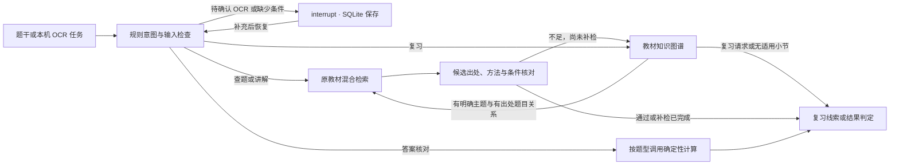

# 知题：可暂停、恢复的 LangGraph 学习流程

2026-11-09 交付本机版本。学生用文字、公式或题图开始一道题。系统能先确认 OCR 或追问缺失条件，之后继续同一道题并返回分组的教材候选、相关考点和可打开的原页。

## 实现



- `study_workflow.py` 用 `StateGraph` 和条件边编排。状态保存当前题干、意图、补充次数、教材候选和执行记录。SQLite 使用独立任务 ID 保存检查点。前端用当前标签的任务 ID 在刷新后取回状态，按当次检查点提交 `Command(resume=…)`。重复提交旧追问会被拒绝。每道任务最多接受两次补充。题干、检查点和题图留在本机。
- OCR 任务从现有服务读取识别稿。学生先对照原图、预览 LaTeX，再提交修订后的题干。支持询问总体模型、待估参数与可选方法。其他缺失情况由现有规则检查处理；本版不自动从模糊题干猜出条件。
- 沿用现有 BGE＋BM25、RRF、题号和公式辅助。每次教材检索保留主召回 20 和每类候选 3 的预算。首次缺乏可推荐证据时，图谱根据题面明确提到的考点及有出处的题目边选一个教材小节，使用原查询限定小节补检一次。补检照常检查候选的出处及条件冲突。图谱关系本身作为复习线索展示。
- 答案核对沿用限定的公平独立骰子最大值计算。讲解只在证据充足且本次提交明确允许时调用已配置模型。引用检查验证引用编号是否可用，推导和引用支持程度还需要核验。意图目前由规则识别，Qwen 歧义路由、多 Agent 审阅和训练暂未接入。

实现参考 [LangGraph Agentic RAG](https://docs.langchain.com/oss/python/langgraph/agentic-rag)、[暂停恢复](https://docs.langchain.com/oss/python/langgraph/interrupts)和[持久化](https://docs.langchain.com/oss/python/langgraph/persistence)。

## 演示与评测

打开 `/agent`，点击「试试补充题目条件」后开始任务。刷新页面，填写「来自正态分布，方差已知」「均值」「最大似然估计」，点击「继续当前题目」。结果分为例题与课后题，并给出考点线索、匹配理由与原页。

浏览器另上传了一道自编正态总体题。真实 OCR 错识别两个下标，并把分布公式切开。刷新后原图和待核对稿仍可用；修正公式后返回最大似然估计、正态分布两条考点线索，1 道例题和 3 道课后题候选。

用相同输入运行 6 个开发场景，比较旧单轮 Agent、LangGraph 单轮、LangGraph 自适应。18 个流程检查全部符合预设结果。单轮组沿用当前检索器内部策略，关闭 LangGraph 的跨请求追问及小节补检。

| 场景 | 观测 |
| --- | --- |
| 估计题缺少模型和参数 | 两个单轮组停在缺条件提示。新版保留同一任务，补充后返回 2 道例题和 3 道课后题候选 |
| Fisher 信息量查题 | 新版按 6.4 节补检 1 次，结果仍未通过推荐规则，保留 6 条有出处的复习路径 |
| 明确教材题号、考点复习、两类骰子判定 | 三组分别保持教材题号定位、图谱复习及可核对或暂无法核验的预期结果 |

```powershell
& ./.venv-rag/Scripts/python.exe -X utf8 -m unittest discover -s tests -p 'test_study_workflow.py'
& ./.venv-rag/Scripts/python.exe -X utf8 evaluate_study_workflow.py --report data/private/agent/2026-11-09-workflow-comparison.json
```

这些是本机开发验证，未调用生成模型。估计题收益来自学生提供的新条件。另有模拟检索的测试验证小节补检能恢复符合条件的候选，本次真实样例仅验证了补检后继续保守判定。下一步用 660B 中经核对且与教材去重的新题，按题族留出评测集，分别标注例题和课后题的相关性，再报告 Recall@3、MRR@3、误推荐率、追问恢复率和时间。若以候选池标注相关性，Recall 的分母限于已判断的候选池。训练优先解决已发现的具体错误，细节见[后训练路线](agent-roadmap.md)。
