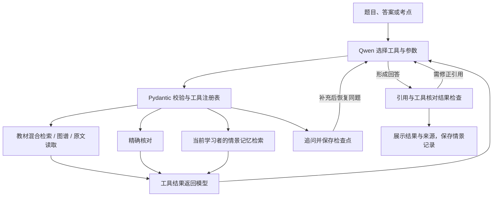

# 知题模型学习 Agent

2026-11-15，围绕新题对应茆书例题、课后题、考点与讲解的目标，接入模型选择工具和情景记忆。原入口为本机 `/agent`，在运行方式里选择「模型选择工具」，勾选当轮模型调用后开始。规则流程可在同一界面切换，用于对照。

## 流程



工具调用循环参考 Hello-Agents 第七章。模型先产生动作，程序执行工具，把观察结果写回消息，再交模型决定下一步。本项目通过原生 Function Calling 传递工具调用及结果，用 LangGraph 保存流程与暂停点。参考项目的记忆/RAG分层用于划分工作状态、过去事件和教材知识的职责。[第七章示例](https://github.com/datawhalechina/hello-agents/blob/2eb1c7547018b519b85cb57acf5533f12d65bf8e/code/chapter7/my_simple_agent.py) · [第八章记忆工具示例](https://github.com/datawhalechina/hello-agents/blob/2eb1c7547018b519b85cb57acf5533f12d65bf8e/code/chapter8/02_MemoryTool_Architecture.py)

## 代码对应

| 文件 | 负责的行为 |
| --- | --- |
| `reasoning_agent.py` | LangGraph 决策、工具执行、追问恢复、引用反馈、调用预算与结果检查 |
| `study_tools.py` | 六个具名工具的 JSON Schema、严格参数校验与本机执行 |
| `study_memory.py` | 学习事件与 BGE 向量存入 SQLite，按当前学习者过滤后精确余弦检索 |
| `full_book_tutor.py` | 已有 BM25、BGE、RRF、公式与条件辅助，例题和课后题分别推荐 |
| `evaluate_reasoning_agent.py` | 显式调用真实模型进行开发场景验收，记录工具轨迹、调用量与失败 |

注册的工具为 `search_textbook`、`read_source`、`knowledge_path`、`check_answer`、`recall_memory`、`ask_clarification`。读取教材原文须先取得相应检索候选或图谱节点。参数定义会拒绝额外字段。核对工具使用任务中保存的原题与用户答案。

每道任务最多 6 次模型请求、8 次工具执行、2 次追问和 2 次引用反馈，原文证据最多 4 条、共 18000 字符。默认模型从本机 `.env` 读取。本轮真实验证使用 Qwen-plus API。任务与学习者编号只适用于本机演示，公开服务还需账户鉴权与访问控制。

## 第八章的记忆如何对应

- 当前题目、补充条件、工具消息及执行位置随任务进入 SQLite 检查点。
- 情景事件保留题目、候选出处、精确计算结果和核验状态。记录按任务 ID 幂等保存，历史生成内容的数学正确性保持待复核状态。
- BGE 在本机生成记忆向量，和事件一并存入 SQLite。检索先限制学习者与模型版本，再在最近 100 条记录中计算相似度，按相似度 0.85 与近因性 0.15 排序，返回 3 条。
- 教材例题、课后题及其原页仍由教材检索和知识图谱工具提供。记忆的回顾用于组织复习。

## 使用与验证

```powershell
& ./.venv-rag/Scripts/python.exe -m pip install -r requirements-agent.txt
./start_demo.ps1
# 真实评测会向本机配置的服务提交题干、工具证据和必要历史
& ./.venv-rag/Scripts/python.exe -X utf8 evaluate_reasoning_agent.py --live
```

模型回复中引用的 E 编号会与已读取原文核对。参数错误会成为工具反馈，模型可修正参数。最终展示同时提供题目条件差异、来源页与工具计算结果。引用支持程度、推导和新题相关性由人工评测继续核对。

## 2026-11-15 开发验收

使用真实 Qwen-plus API 跑六个自编开发场景：查题、带教材引用的讲解、复习路径、数值核对、追问恢复和历史回顾。一次完整流程验收中六项均达到预设终态，共 18 次模型请求和 11 次工具执行；新增出处检查后，核对与追问恢复两项真实复测通过。早期两次完整尝试分别通过 5/6，重复检索耗尽预算、只在普通文本追问而未创建表单等失败均留在本机开发记录。

该检查判断工具、终态、指定题目是否出现、精确工具结果及检查点恢复，不评判一般数学推导正确率，不等于独立 benchmark。真实调用的耗时和 token 用量逐次保留在本机 `data/private/agent/`，不把重复尝试汇总成独立题量。本轮后端 291 项测试和前端 12 个测试文件通过，其中新增 10 项 Agent 测试覆盖工具消息、恢复、隔离、错误引用、动作反馈与调用预算。
