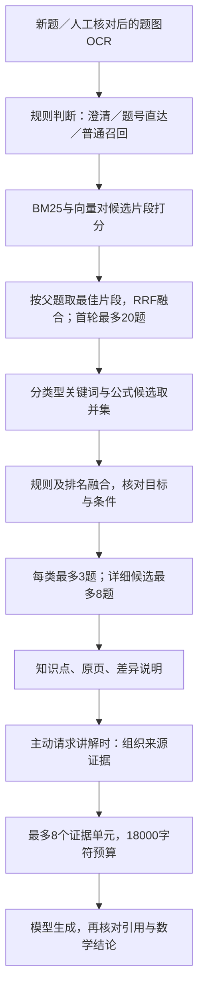

# 召回、Top K、排序与评估：结合本项目理解

更新：2026-11-05。说明当前实现；本次没有新增生成模型或LLM评审调用。

## 1. “召回”是一个动作，Recall是评价它的一个指标

召回阶段从1009条教材记录中找出一批可能相关的题。它追求先别漏掉有用题，不要求所有候选都适合立即展示。后续再去重、融合排序、核对条件，选少量题给学生看。

例如输入“正态总体均值未知，如何估计方差”，召回中可能出现方差估计、均值估计和假设检验等题。排序要把真正可参考的题往前放；分布相同但任务不同的题，要标出区别。相似分数不等于正确概率。



普通查题到G就结束，不请求生成模型。已有明确教材题号时可以绕过普通召回；缺关键条件时先追问。

## 2. Top K不能只设置一个

K表示某个阶段最多保留多少项。它必须同时说明阶段、计数单位及作用范围。

| 阶段 | 默认数量上限 | 当前代码含义 |
| --- | --- | --- |
| 首轮混合候选 | 20道父题 | 全库打分、按题聚合、RRF后保留20题 |
| 分类型关键词补充 | 例题20／课后题20 | 防止某类题被全局候选挤掉 |
| 公式模式候选 | 每次20题 | 适用的公式分支才执行 |
| 公式字符候选 | 每次12题 | 达到内部强匹配条件才参与对应排序 |
| 分类型融合中间结果 | 每类20题 | 对候选并集重新排序后保留；不是神经交叉编码器 |
| 页面复习推荐 | 例题3／课后题3 | 最多各3题，可能不足；并非全局前三拆成两组 |
| 页面详细题干列表 | 8题 | 与复习推荐分组不是同一列表 |
| 知识导航输入 | 主列表3题＋每类2题，去重 | 用于教材知识条目导航，不等于全部进入生成提示 |
| 生成证据 | 最多8个单元、18000字符 | 单元可能是定理、性质、题干或原例讲解，不是8道题 |

对应配置：`retrieval_policy.py`；主流程：`full_book_tutor.py`；生成证据：`rag_generation.py`。

一个容易误说的地方：当前小库用NumPy精确计算向量相似度，BM25也对片段打分，然后按父题聚合、对完整名次RRF，最后取首轮20题。并不是已实现“BM25先取20＋向量先取20”。补充通道再取并集，候选总数也可能超过20。

“先召回20，最终展示3”主要控制筛选范围及阅读负担。当前主要打分工作仍覆盖全部允许片段，不能声称从20改成10会让嵌入计算量减半。以后扩展到大库，才需要另外设计各检索通道的Top N与近似搜索。

查题页展开“查看知识点与教材阅读路径→这次如何检索”，可看到配置预算、实际推荐数量和轨迹中的各通道数量及候选ID。预算是上限，实际执行以当前路由和轨迹为准。

## 3. 召回后具体做什么

1. **按题去重**：同一题有多个片段，各通道取其中最高分，避免长题获得多票。
2. **融合**：BM25与向量使用RRF名次融合，不直接相加不同量纲的分数。
3. **补充**：分类型词法、公式模式和公式字符结构提供额外候选，不能直接把语义候选全部替换掉。
4. **对应排序**：结合显式分布、任务、条件与排名，惩罚目标不符、条件冲突和纯背景材料。这里是规则排序，没有接入神经reranker。
5. **展示与导航**：分别推荐例题和练习，附差异、知识点和原页。
6. **可选生成**：从结果中选择完整来源单元，标注E编号，按预算送入Qwen-plus API。引用编号存在只证明编号有效，不能证明推导正确。

## 4. 检索指标怎样算

先由人工建立每条输入的相关题集合R，再将检索结果按父题去重，取前K题P。片段不能当成多道正确题。

| 指标 | 定义 | 本项目回答的问题 |
| --- | --- | --- |
| Precision@K | 前K个位置中相关题数／K | 学生看到的推荐有多少有用？ |
| Recall@K | 找回的相关题数／全部相关题数 | 应该参考的题有没有漏掉？ |
| RR@K | 第一条相关题名次的倒数；前K没有则0 | 第一条有用题是否足够靠前？ |
| MRR@K | 多条查询RR@K的平均 | 学生通常多久能看到第一条有用题？ |
| Hit@K | 前K至少出现一条目标／相关题记1，再求平均 | 能否至少找到一个目标？ |

例：人工确认相关题是A、B、C，返回前三为“不相关X、A、B”，则Precision@3=2/3，Recall@3=2/3，RR@3=1/2。若只返回A一题，本协议的Precision@3为1/3，固定使用K个位置作为分母；不要与其他工具的“按实际返回数量”口径混用。

MRR需要知道第一条真正相关题的名次。若前面还有未标注题，就不能擅自当作不相关。Recall还要求明确相关题集合的范围；只审核了候选池，不能声称穷尽全书相关题。

目前24条数据只知道预定出处ID，其他候选未经过完整相关性审核，因此报告的是**出处Hit／MRR代理**。不能把“另一个合理相关题”当作错误，也不能将代理命中率改名为完整相关性Precision或Recall。

本次新增：`retrieval_metrics.py`、`evaluate_labeled_retrieval.py`及`evaluation/题目相关性评测协议.json`。未标注项保持null；不完整标签下，无法可靠计算的指标保持空值。输出还显示可评分样本数，避免仅对少量可评分题求平均却掩盖其余缺失。

## 5. 生成指标怎样理解

| 指标 | 评什么 | 不代表什么 |
| --- | --- | --- |
| Faithfulness | 回答主张是否由实际检索证据支持 | 证据自身正确、数学推导正确 |
| Answer／Response Relevancy | 回答是否回应题目、所求量与讲解请求 | 最终结论一定正确 |
| 数学正确性 | 条件、方法、推导、计算与答案是否成立 | 可以单靠引用存在判断 |
| 引用支持 | 被引用原文是否支持对应主张 | 只有E编号合法就通过 |

Ragas官方定义可参考[Faithfulness](https://docs.ragas.io/en/stable/concepts/metrics/available_metrics/faithfulness/)与[Response Relevancy](https://docs.ragas.io/en/stable/concepts/metrics/available_metrics/answer_relevance/)。自动LLM评分也会出错，需保留逐条理由并抽查；本轮未运行此类评分，不存在新增Ragas成绩。

另需区分[Ragas Context Recall](https://docs.ragas.io/en/stable/concepts/metrics/available_metrics/context_recall/)的实现类型：基于参考答案主张的覆盖，和基于文档ID的召回率，计数单位不同。本项目先采用题目ID指标，不把两者直接混算。

统计题还有特殊情况：学生改了参数后，正确讲解需要重新推导。不能为了提高表面的faithfulness，直接照抄教材原题数字。建议把“教材方法依据”和“新参数下的推导与计算”分开人工核对。

## 6. 本次实际对照与默认值选择

冻结同一24条已知出处改写开发题，旧代码和旧索引先运行；新分块在独立候选索引建立并对照，通过后才替换服务索引。旧数据库及各次候选版保留。

| 检查 | 优化前 | 最终优化后 |
| --- | --- | --- |
| 父题记录数 | 1009 | 1009 |
| 检索片段数 | 1094 | 1070 |
| 命令／配对花括号内部切点 | 75处／38条记录 | 本次扫描0处 |
| 当前题干字符覆盖 | 完整 | 完整 |
| 最大嵌入输入tokens | 332 | 337，低于480预算 |
| 向量出处Hit@3 | 18/24 | 19/24 |
| 最终对应出处Hit@1 | 22/24 | 22/24 |
| 最终对应出处Hit@3 | 23/24 | 23/24 |

切分保护覆盖命令、花括号、常见数学定界符、公式环境和数字，仍不是完整TeX语法分析。320字符现在是软目标：优先完整题、句子和公式，必要时合并很短尾部或容纳完整公式；480 tokens是硬上限。超长不可完整容纳的单元仍可能被迫切分，但会记录警告。本次入库语料没有触发这种强制切分；实际片段11—510字符、25—337 tokens。OCR与例题边界的原有问题仍需审核。

四组开发参数对照中，公式候选上限固定20、字符候选固定12；分别改变首轮和分类型词法预算，最终每类先取5题以比较展示K：

| 首轮K | 分类型BM25 K | 出处Hit@1 | 出处Hit@3 | 出处Hit@5 |
| --- | --- | --- | --- | --- |
| 10 | 10 | 21/24 | 22/24 | 23/24 |
| 10 | 20 | 21/24 | 22/24 | 23/24 |
| 20 | 10 | 22/24 | 23/24 | 23/24 |
| 20 | 20 | 22/24 | 23/24 | 23/24 |

保留默认首轮20、词法每类20、展示每类3。首轮10在这批题上损失定位，展示5未额外找回出处；词法10与20打平，不足以证明可以普遍缩减。没有做神经重排、模型替换或完整参数网格搜索，不能称这些值已经最优。实验耗时受缓存和顺序影响，只作诊断，不新增速度提升成绩。

证据入口：`data/private/chunk-topk-20261105/promotion.json`。采用的最终测量为`candidate-113902/report.json`，基线为`baseline-104012/report.json`；中间候选版也保留。此前11月4日效果页面继续显示原冻结快照，代码变化后显示过期提示，不悄悄替换旧测量。

## 7. 自制集与benchmark怎样安排

自制集可以形成规范的领域评测，关键在题源、标注、冻结与数据隔离，不在是否有一个公开名字。下一步应先新增未参与调参的学生题／教师改写题，覆盖自然语言、符号改写、条件改变、同分布不同目标、缺条件、OCR错误及无相关题。

例题与课后题分别标0—3级；达到2级才计相关；知识点标签另行审核。多位教师可独立标注后仲裁，并保留分歧。原文出处代理、候选池相关性、完整人工相关集和学生试用分别报告，不混算成一个准确率。

以后接入公开benchmark时，需要其查询、语料与qrels一致。统计学解题题库若没有“到茆书相关例题”的标签，只能用于生成正确性或另建映射，不能直接充当本项目检索Recall基准。开发集选配置，冻结后的独立集只验收；测试失败不能偷偷回填开发后继续称独立测试。

## 8. 可以自己复现的最短练习

1. 选一条题，展开网页检索轨迹，找到首轮实际候选数、每类候选并集和最终ID；指出哪一步有数量上限。
2. 将上面X、A、B的例子手算一遍，再运行`retrieval_metrics.evaluate()`核对。
3. 在人工审核模板里填3条输入的相关性等级，运行下面命令。未审核题保持空，不改成0。

```powershell
& '.\.venv-rag\Scripts\python.exe' -X utf8 evaluate_labeled_retrieval.py `
  data/private/chunk-topk-20261105/relevance-review-template.json `
  data/private/chunk-topk-20261105/manual-metrics.json
```

模板初始未填任何教师相关性标签；输出应为空指标或仅有明确可计算的项目，不是错误。这比生成漂亮但无依据的百分比更适合支持后续调优。
